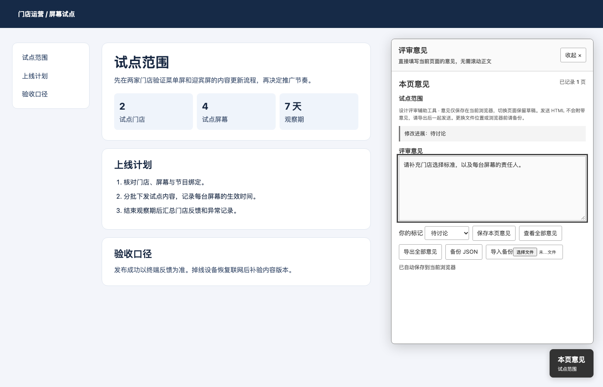
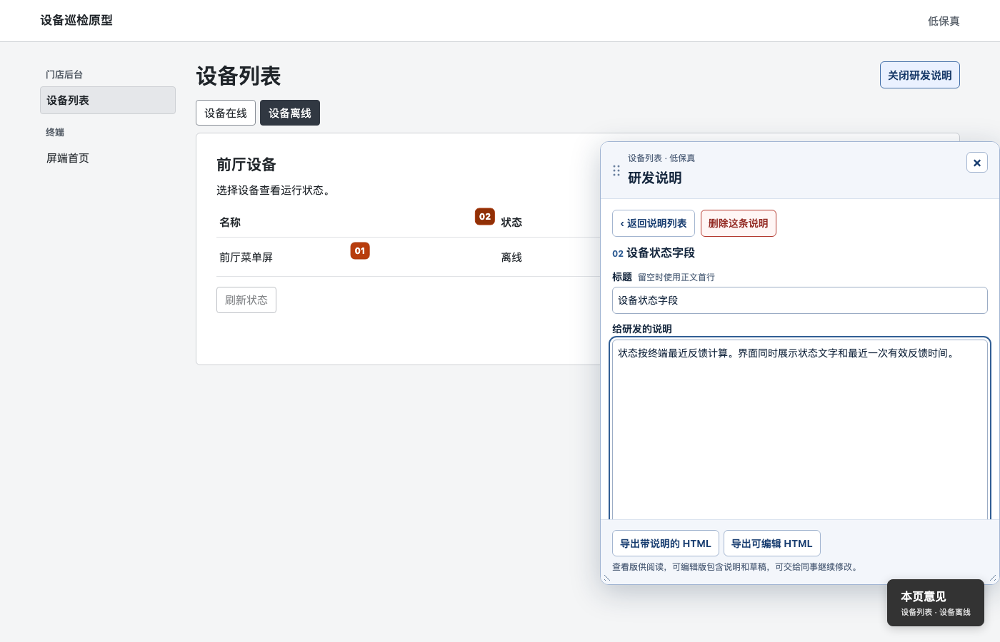

# GuanMao 评审

给现有 HTML 加上逐页评审，或把需求做成可点击、可批注、可离线交给研发的低保真原型。可以按章节评审报告，按页评审 PPT 或静态设计稿，按页面和场景评审交互原型。

## 快速使用

在 Codex 对话里选择 **GuanMao 评审**，也可以用完整名称 `$guanmao-design-review` 或简称 `$gm-review` 接上需求。

| 你手头有什么 | 可以直接这样说 | 会得到什么 |
| --- | --- | --- |
| 现有 HTML 报告 | 用 `$gm-review` 给这份 HTML 报告加上本页意见，按原有章节记录。 | 保留原报告和导航的评审稿，支持按章节填写和汇总意见。 |
| PPT 或静态设计图 | 用 `$gm-review` 把这些页面做成逐页查看的 HTML 评审稿，每页都能留意见。 | 可用浏览器翻阅的 HTML，意见跟随具体幻灯片或设计稿。 |
| 新功能需求 | 用 `$gm-review` 给门店设备管理做一版低保真，演示在线和离线两种场景。 | 带场景切换、本页意见和研发说明的可点击原型。 |
| 已有原型和评审记录 | 用 `$gm-review` 对照这份 Markdown 意见逐项更新原型，保留原有页面 ID。 | 可继续评审的新版原型。 |

## 实际效果

以下图片用示例数据在 Chrome 中打开实际生成的 HTML 后截取。

### 报告按章节评审

报告保留章节导航。打开右下角的「本页意见」即可为当前章节填写意见，切换回来能接着写。左侧继续阅读正文，右侧可查看保存状态和导出入口。



### 低保真原型带场景切换

示例包含后台设备列表和屏端首页。在线和离线可以分别评审。终端示例还能切换横竖屏、模拟遥控操作。


### 在画布上补充研发说明

打开「研发说明」后，画布显示橙色编号。点编号可以编辑标题和正文，拖编号可以调整位置。浮窗可以移动和缩放，方便边看原型边写规则。



### 离线查看研发说明

只读 HTML 随文件携带已填写的说明。研发用浏览器打开后，可以操作原型、点编号读说明，也可以打开说明列表逐条查看。


## 两类记录怎么用

| 入口 | 用途与归档方式 | 保存和交接 |
| --- | --- | --- |
| **本页意见** | 收集设计反馈。报告按篇或按章，PPT 和静态稿按页，交互原型按页面与场景。 | 浏览器自动存草稿。导出 Markdown 供逐项修改，导出 JSON 用于备份和合并。 |
| **研发说明** | 给研发补充字段定义、按钮规则、异常处理。原型每页独立编号，同页不同场景共用说明。 | 点击任意位置新增，支持拖动编号、整行排序和批量删除。可导出只读版或可编辑版，可编辑版保留标题、正文、位置、顺序和空白草稿。 |

「保存并继续添加」会先保存当前说明，再进入下一条的落点模式。保存失败时，编辑区保留输入的内容并提示重试。交付给同事时，通过页面上的导出按钮生成新文件，或把评审意见一并导出。浏览器草稿与打开它的浏览器环境相关。

## 安装

- **Codex**。将完整的 `guanmao-design-review/` 目录放进 `~/.agents/skills/`，或创建指向源码的符号链接。启用 `$gm-review` 请参阅[短入口安装方法](references/interaction-spec.md#安装短入口)。
- **Claude Code**。将完整目录放进 `~/.claude/skills/`，然后用 `/guanmao-design-review` 调用。
- **WorkBuddy 或支持自定义 Skill 的 Claude 环境**。打包并导入完整目录，保留 `assets/`、`references/` 和 `scripts/`。能读取这些资源、执行 Python 3 并交付 HTML 的环境可以运行本文的打包流程。

## 直接用脚本生成 HTML

在仓库根目录运行。构建脚本使用 Python 3 标准库。

```sh
# 生成仓库自带的后台与屏端示例
python3 scripts/build_html.py assets/prototype-template/index.html prototype-review.html

# 给现有 HTML report.html 加上固定评审入口
python3 scripts/build_html.py report.html report-review.html --attach-review ops-report
```

生成的示例可用浏览器离线打开。直接添加评审会保留原 HTML 的资源引用，如果报告依赖同目录的文件，把报告和评审副本放在一起。章节导航、动态翻页、稳定页面 ID 和旧草稿迁移的接入方法见[交互和接入规范](references/interaction-spec.md)。

## 目录

| 路径 | 作用 |
| --- | --- |
| [`SKILL.md`](SKILL.md) | 智能体使用的任务流程和交付要求 |
| [`references/interaction-spec.md`](references/interaction-spec.md) | 评审、研发说明和离线打包的接入规则 |
| [`assets/prototype-template/`](assets/prototype-template/) | 可复制的原型模板，包含后台和屏端示例 |
| [`assets/components/`](assets/components/) | 独立复用的评审和研发说明组件 |
| [`scripts/build_html.py`](scripts/build_html.py) | 生成离线 HTML 或为现有 HTML 添加评审 |
| [`aliases/gm-review/`](aliases/gm-review/) | 指向同一份 Skill 的 Codex 短入口 |
