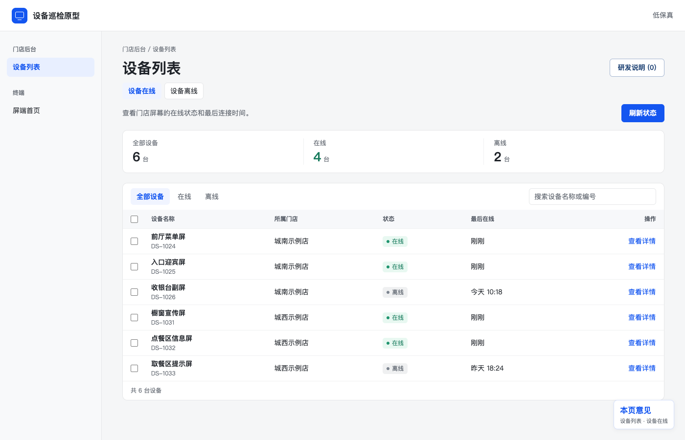
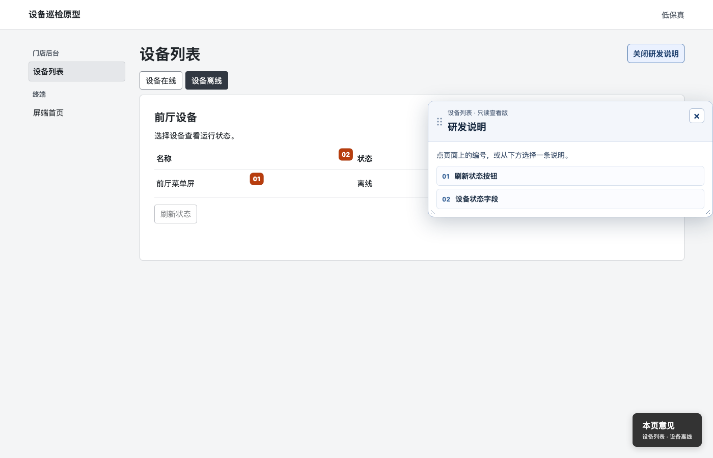
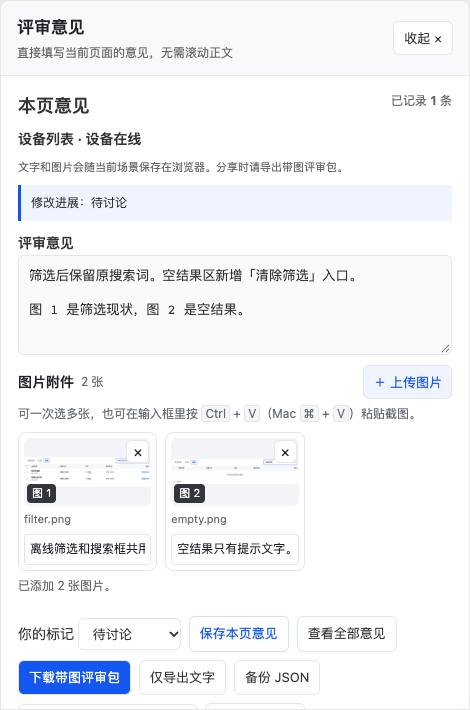

# GuanMao 评审 · PRD 转原型与 HTML 评审

把 PRD（产品需求文档）或需求清单做成可点击的低保真 HTML 原型。给已有 HTML 添加评论、批注和评审意见，也能把网页报告、PPT、UI 设计稿和静态图片做成逐页评审稿。评审意见可带截图导出给智能体，研发说明可随 HTML 离线交接。

An agent skill for PRD-to-prototype workflows, clickable HTML wireframes, page-by-page design review, and offline developer handoff.

## 快速使用

在 Codex 对话里选择 **GuanMao 评审**，也可以用完整名称 `$guanmao-design-review` 或简称 `$gm-review` 接上需求。

| 你手头有什么 | 可以直接这样说 | 会得到什么 |
| --- | --- | --- |
| **PRD 或产品需求清单** | 用 `$gm-review` 把这份 PRD 做成可点击原型，演示提交成功、失败和重试。 | 可离线打开的低保真 HTML 原型，带场景切换和评审入口。 |
| **现有交互原型** | 用 `$gm-review` 给这版设备管理原型加逐页评审，让在线和离线场景能分别留意见。 | 可按页面和场景填写意见的原型，保留现有导航与交互。 |
| **任意已有 HTML 页面** | 用 `$gm-review` 给这份 HTML 加一个评论入口，能粘贴截图并导出意见。 | 带「本页意见」的 HTML，文字和图片跟随当前页保存。 |
| **网页报告或运营方案** | 用 `$gm-review` 给这份 HTML 报告按章节加批注，切换章节后还能接着写。 | 按章节定位和汇总反馈的报告评审稿。 |
| **PPT 或演示文稿** | 用 `$gm-review` 把这些幻灯片做成逐页评审 HTML，每张都能留意见。 | 可在浏览器逐页查看的评审稿，意见关联到具体幻灯片。 |
| **UI 设计稿、原型图或静态截图** | 用 `$gm-review` 把这些 UI 截图做成可翻页的 HTML 评审稿，逐页收集设计反馈。 | 可逐页填写意见、粘贴图片和汇总导出的评审稿。 |
| **带图评审意见** | 用 `$gm-review` 读评审包里的 `review.md` 和对应图片，逐项更新原型。 | 按页面、场景和截图定位修改点，保留页面 ID 便于继续评审。 |
| **研发交接** | 用 `$gm-review` 在原型上补充字段规则、异常处理和参考截图，并导出只读 HTML。 | 带编号、说明和原图的离线交付稿，研发可点击查看。 |

## 实际效果

以下图片用示例数据在 Chrome 中打开实际生成的 HTML 后截取。

### 报告按章节评审

报告保留章节导航。打开右下角的「本页意见」即可为当前章节填写意见，切换回来能接着写。左侧继续阅读正文，右侧可查看保存状态和导出入口。


### 低保真原型带场景切换

新建后台原型默认采用蓝白浅色，表格上方提供筛选和搜索，行内用标签标记状态，操作统一靠右。示例包含设备列表和屏端首页。在线和离线场景可以分别评审，终端还能切换横竖屏、模拟遥控操作。



### 在画布上补充研发说明

打开「研发说明」后，画布显示橙色编号。点编号可编辑标题和正文，也可以上传多张图片或直接粘贴截图。拖编号可调整位置，浮窗可移动和缩放。


### 离线查看研发说明

只读 HTML 随文件携带已填写的说明和图片。研发用浏览器打开后，可以操作原型、点编号读说明，点击缩略图查看原图或切换图片。



### 导出带图评审意见

在「本页意见」里上传多张图，或在正文里按 Ctrl+V（Mac 用 Cmd+V）粘贴截图。每张图有编号，可以选填一句说明。



点击「下载带图评审包」。解压 ZIP，把 `review.md` 和 `images/` 一起交给智能体。Markdown 会记录每条意见的页面、场景、正文、图号和原图路径，智能体可打开对应图片核对。只需传文字时可以选「仅导出文字」。

## 两类记录怎么用

| 入口 | 用途与归档方式 | 保存和交接 |
| --- | --- | --- |
| **本页意见** | 收集设计反馈。报告按篇或按章，PPT 和静态稿按页，交互原型按页面与场景。 | 浏览器自动存草稿。带图 ZIP 可交给智能体，JSON 可备份和合并。 |
| **研发说明** | 给研发补充字段定义、按钮规则、异常处理。原型每页独立编号，同页不同场景共用说明。 | 点击任意位置新增，支持拖动编号、整行排序和批量删除。两种 HTML 都包含图片，可编辑版还保留空白草稿。 |

「保存并继续添加」会先保存当前说明，再进入下一条的落点模式。保存失败时，编辑区保留输入的内容并提示重试。交付给同事时，通过页面上的导出按钮生成新文件，或把评审意见一并导出。浏览器草稿与打开它的浏览器环境相关。

## 安装

- **Codex**。将完整的 `guanmao-design-review/` 目录放进 `~/.agents/skills/`，或创建指向源码的符号链接。启用 `$gm-review` 请参阅[短入口安装方法](references/interaction-spec.md#安装短入口)。
- **Claude Code**。将完整目录放进 `~/.claude/skills/`，然后用 `/guanmao-design-review` 调用。
- **WorkBuddy 或支持自定义 Skill 的 Claude 环境**。打包并导入完整目录，保留 `assets/`、`references/` 和 `scripts/`。能读取这些资源、执行 Python 3 并交付 HTML 的环境可以运行本文的打包流程。

## 直接用脚本生成 HTML

在仓库根目录运行。构建脚本使用 Python 3 标准库。

```sh
# 生成仓库自带的后台与屏端示例
python3 scripts/build_html.py assets/prototype-template/index.html prototype-review.html

# 给现有 HTML report.html 加上固定评审入口
python3 scripts/build_html.py report.html report-review.html --attach-review ops-report
```

生成的示例可用浏览器离线打开。直接添加评审会保留原 HTML 的资源引用，如果报告依赖同目录的文件，把报告和评审副本放在一起。章节导航、动态翻页、稳定页面 ID 和旧草稿迁移的接入方法见[交互和接入规范](references/interaction-spec.md)。

## 目录

| 路径 | 作用 |
| --- | --- |
| [`SKILL.md`](SKILL.md) | 智能体使用的任务流程和交付要求 |
| [`references/interaction-spec.md`](references/interaction-spec.md) | 评审、研发说明和离线打包的接入规则 |
| [`assets/prototype-template/`](assets/prototype-template/) | 可复制的原型模板，包含后台和屏端示例 |
| [`assets/components/`](assets/components/) | 独立复用的评审和研发说明组件 |
| [`scripts/build_html.py`](scripts/build_html.py) | 生成离线 HTML 或为现有 HTML 添加评审 |
| [`aliases/gm-review/`](aliases/gm-review/) | 指向同一份 Skill 的 Codex 短入口 |
